# Turkcell Geleceği Yazanlar BiP Night Case 3

https://github.com/user-attachments/assets/537b7e2a-6533-4f6c-be1c-df10ca003667

> Tam çözünürlüklü sürüm: [assets/demo.mp4](assets/demo.mp4)

## 🏆 Proje Başarısı: 1.

> Turkcell Geleceği Yazanlar BiP Night 2026 için arkadaşlarım **Ömer Tuğrul Bayram** ve **Ecem Karadaş** ile birlikte hazırladığımız çalışma. Uzun süren bu emeğin sonunda programı **birincilikle** tamamladık; emekleri ve katkıları için ikisine de çok teşekkür ederim.

Case'in iki yarısını tarayıcıda çalışan, tıklanabilir prototipler olarak hazırladık. İkisi de tek dosya, bağımlılık yok.

| | Prototip | Canlı demo | Klasör |
|---|---|---|---|
| **Case 3A** | BiP Arama: arama deneyiminin yeniden tasarımı | https://bipnight-eight.vercel.app/ | `arama/` |
| **Case 3B** | BiP Kelime: günlük kelime oyunu | https://omertugrulbayram.github.io/bipnight/ | `kelime/` |

---

## Case 3A · BiP Arama

### Çözdüğümüz problem

Farklı dil, yaş ve bağlantı koşullarındaki kullanıcılar arama sırasında birbirini anlamakta, kontrolleri bulmakta ve sistemin ne yaptığını görmekte zorlanıyor. Üç kişiden yola çıktık:

- **Ayşe:** Yurt dışındaki ekibiyle görüşüyor, kendi dilinde altyazı ve sonradan okunabilen kayıt istiyor.
- **Hasan:** Küçük ikonlarda kayboluyor, aramayı yanlışlıkla kapatıyor, az sayıda büyük ve yazılı kontrol istiyor.
- **Deniz:** Kalabalık gruplarda kimin konuştuğunu göremiyor, düzenli ızgara istiyor.

### Neler yaptık

| Alan | Değişiklik |
|---|---|
| **Arama başlatma** | 31 kişiye kadar seçilebilen "Yeni arama"; iPhone gibi standart "Çalıyor…" durumu; gelen aramada Yanıtla, Reddet ve Mesajla yanıtla. |
| **Cevap yok** | Tekrar ara, sesli mesaj, mesaj yaz ve hazır yanıtlar. |
| **Birebir görüntülü** | Tam ekran video, sürüklenip köşeye yapışan kendi görüntün, karşı tarafın mikrofonu kapalı göstergesi. |
| **Bağlantı sorunları** | Zayıf bağlantıda "Sesliye geç / Kolay moda geç". Kopunca sayaçlı "Yeniden bağlanıyor", "Mobil veriye geç / Kapat, tekrar ara". |
| **Kolay mod** | Büyük etiketli 3 kontrol, sade ekran. |
| **Grup araması** | 8 kişiye kadar eşit kartlar, konuşan vurgusu, "Konuşan öne çıkar" görünümü, sürükleyerek yer değiştirme. Sesli grupta profil baloncuğu, görüntülü grupta tam kart. |
| **Katılımcı yönetimi** | Liste, sustur, onaylı "Aramadan çıkar". "Kişi ekle" her zaman seçim listesi açar; birebir arama kesilmeden gruba dönüşür. |
| **Dil desteği** | Canlı altyazı ve çeviri (5 dil, okuma dili seçimi, 3 yazı boyutu). Konuşma kaydında ara, dosyaya kaydet, panoya kopyala. |
| **Çoklu görev** | Birebir ve grup için sürüklenebilir küçük ekran (PiP), arama içi sohbet, sesli mesaj, ekran paylaşımı durumu. |
| **Aramalar sekmesi** | Gelen, giden ve cevapsız geçmişi, arama bilgisi, tek dokunuşla tekrar arama. |

### Ekran görüntüleri

<table>
<tr>
<td align="center" valign="top" width="33%">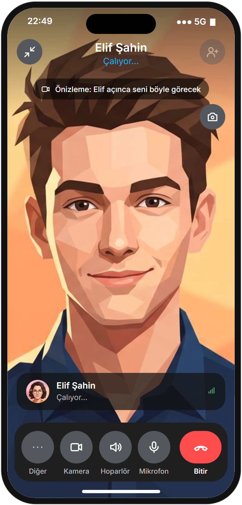 <b>Çalıyor…</b> Standart "Çalıyor…" durumu. Karşı taraf açmadan kendi kamera önizlemeni görürsün.</td>
<td align="center" valign="top" width="33%">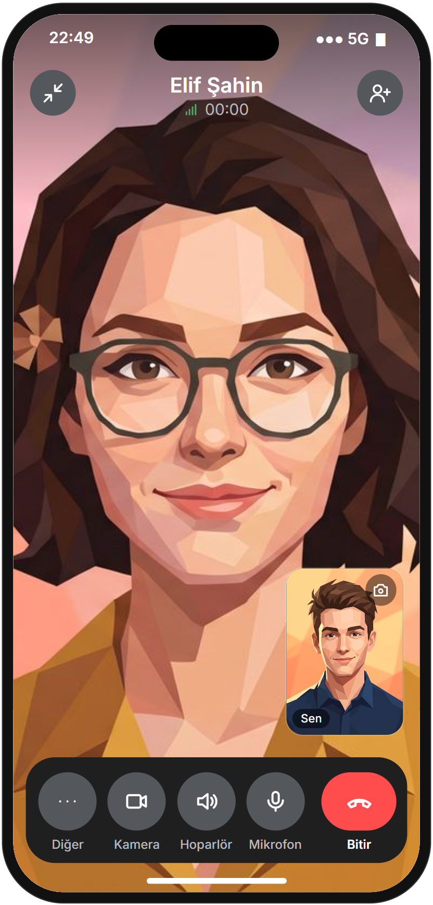 <b>Bağlandı</b> Tam ekran video, köşede kendi görüntün. Görüntülü aramada sabit beş kontrol: Diğer, Kamera, Hoparlör, Mikrofon, Bitir.</td>
<td align="center" valign="top" width="33%">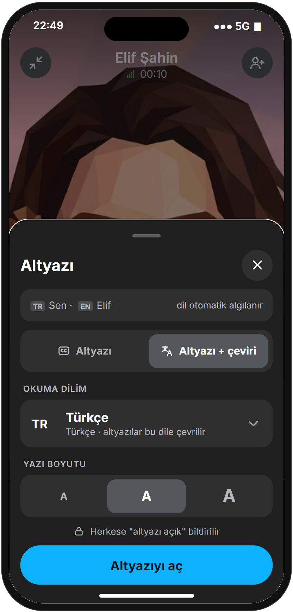 <b>Altyazı ayarı</b> Altyazı ya da altyazı + çeviri, okuma dili ve yazı boyutu tek yerde.</td>
</tr>
<tr>
<td align="center" valign="top">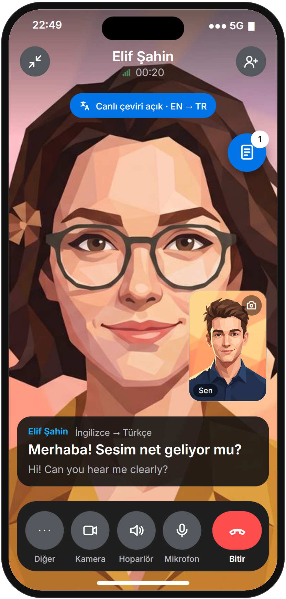 <b>Canlı çeviri</b> Karşı tarafın İngilizcesi konuşma anında yazıya dökülür ve Türkçeye çevrilir.</td>
<td align="center" valign="top">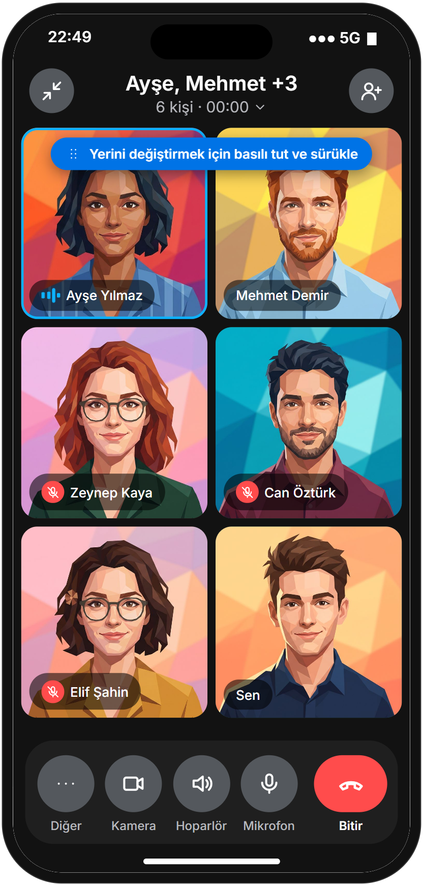 <b>Görüntülü grup</b> Eşit kartlar. Konuşan kişi mavi çerçeveyle, sessizde olanlar simgeyle görünür.</td>
<td align="center" valign="top">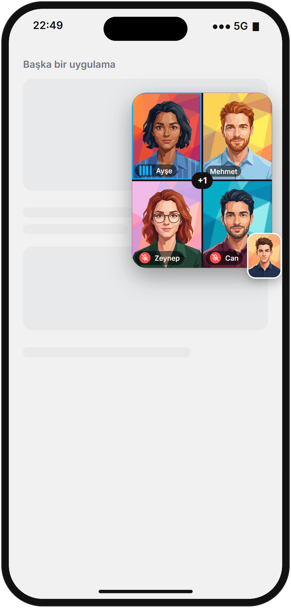 <b>Küçük ekran</b> Başka uygulamaya geçince ilk dört kişi ve sen küçük pencerede kalırsın, pencereyi köşelere sürükleyebilirsin.</td>
</tr>
<tr>
<td align="center" valign="top">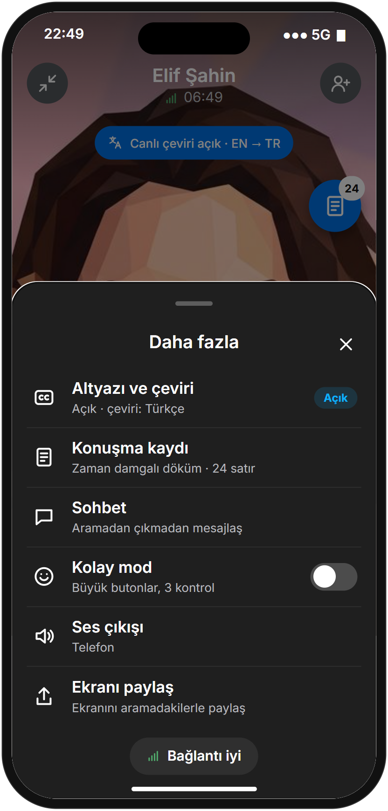 <b>Diğer menüsü</b> Az kullanılanlar tek yerde: altyazı, konuşma kaydı, sohbet, kolay mod, ses çıkışı, ekran paylaşımı.</td>
<td align="center" valign="top">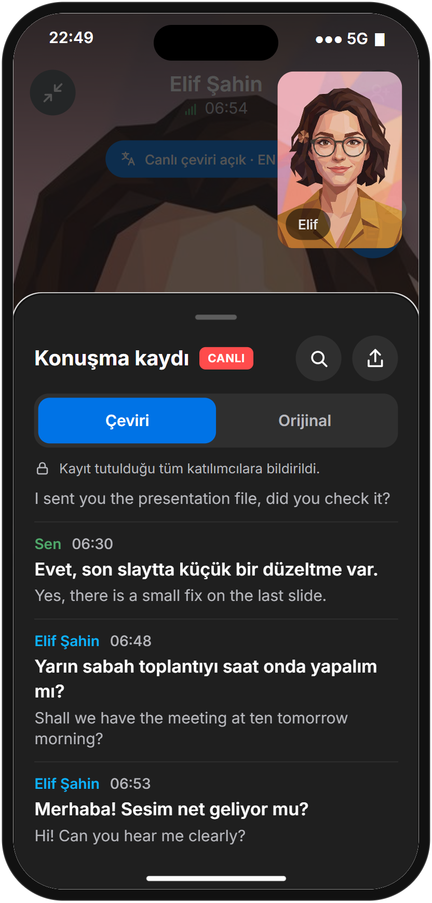 <b>Konuşma kaydı</b> Çevrilen cümleler zaman damgasıyla birikir (Çeviri ve Orijinal sekmeleri). Kaçırdığın cümleyi kayıtta arayıp bulabilirsin.</td>
<td align="center" valign="top">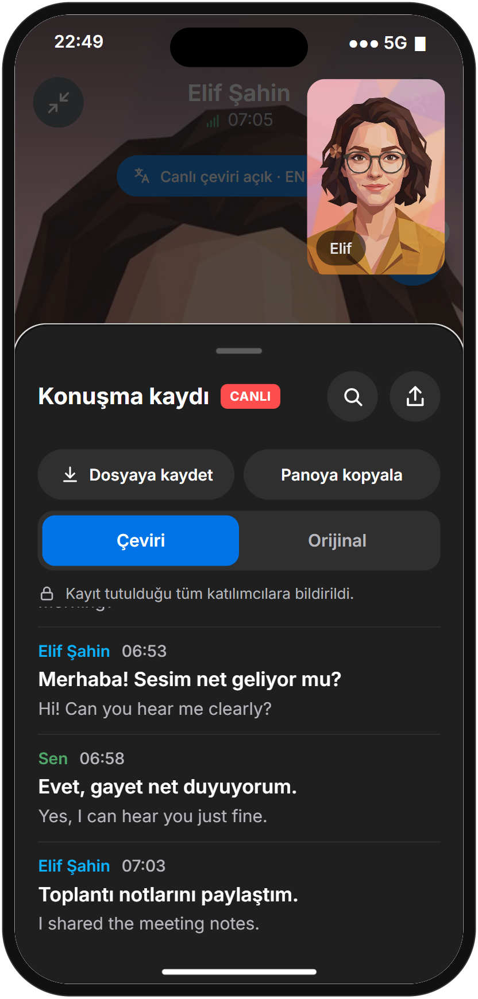 <b>Kaydı sakla</b> Konuşma kaydını .txt dosyası olarak kaydet ya da panoya kopyala.</td>
</tr>
</table>

### Tasarım sistemi

- **BiP renk kartelası** birebir uygulandı: Light ve Dark modun isimli 169 renk token'ının tamamı kartelayla aynı. Arama ekranı her temada koyu.
- Birincil kontroller sabit sırada, **Bitir** butonu ayrı renk ve boyutta (yanlışlıkla basmaya karşı).
- Renk tek başına anlam taşımaz: her durum ikon, dolgu ve yazıyla ayrışır.
- Büyük dokunma alanları (kontroller 56 px), ekran okuyucu etiketleri, `prefers-reduced-motion` desteği.
- Yazı tipi: Inter (dosyaya gömülü).

### Demoyu gezme

- Üstteki **Gelen sesli arama** ve **Gelen görüntülü arama** butonları gelen arama akışını açar.
- Aramalar listesinden bir satıra dokunarak tekrar arayabilir, **+** ile yeni arama başlatabilirsin.
- Doğrudan ekran açmak için: `?ekran=07` (zayıf bağlantı), `?ekran=13` (kalabalık grup), `?ekran=22` (katılımcılar). Tema için `?tema=koyu` veya `?tema=acik`.

---

## Case 3B · BiP Kelime

Case'in diğer yarısı ayrı bir depoda geliştirildi ve bu projeye **`kelime/`** altında eklendi. Kaynak depo: https://github.com/omertugrulbayram/bipnight (commit `16fac0d`).

`kelime/index.html` tek dosyadır: BiP 5.6'nın web kopyasının içine yeniden tasarlanan **BiP Kelime** ve mikro animasyonların **hareket dili** sayfası gömülü. İnternet gerekmez.

**Neler yaptık:** günlük kelime oyunu, seri ve dondurucu, bildirimler, liderlik, profil, erişilebilirlik ve karanlık mod. **Denemek için:** Kanallar → Keşfet → Oyunlar → BiP Kelime → **Oyna**. Demo kelimesi: **KALEM**.

### Ekran görüntüleri

<table>
<tr>
<td align="center" valign="top" width="33%">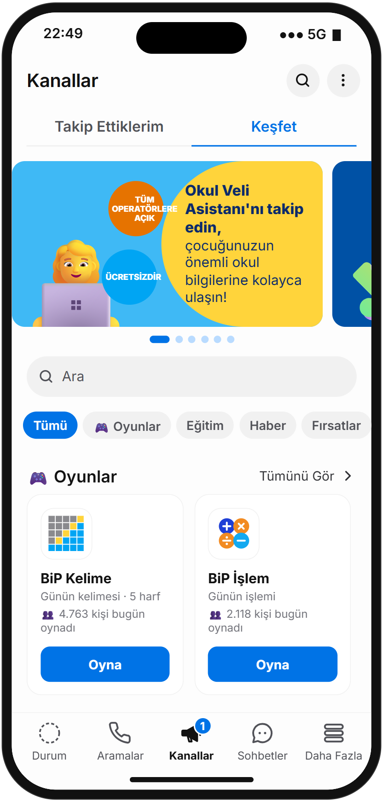 <b>Keşfet'te bul</b> Oyun BiP'in içinde: Kanallar → Keşfet'ten tek dokunuşla başlar, indirme ve kurulum yok.</td>
<td align="center" valign="top" width="33%">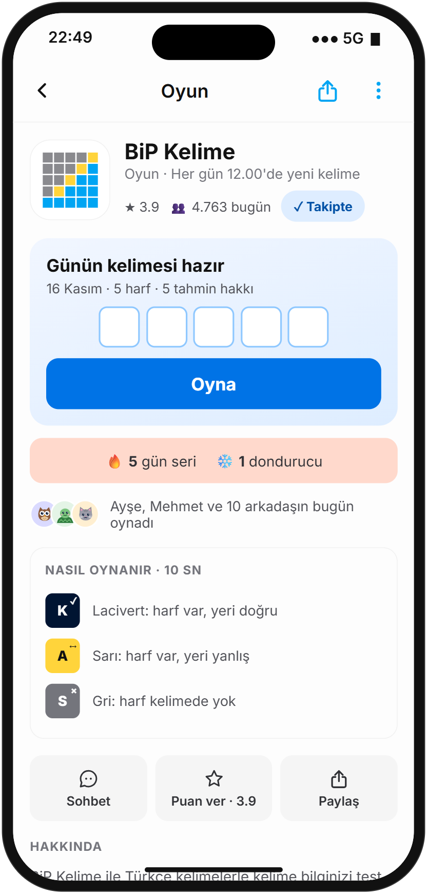 <b>Oyun sayfası</b> Günün kelimesi hazır. Seri, dondurucu ve 10 saniyelik "Nasıl oynanır?" anlatımı.</td>
<td align="center" valign="top" width="33%">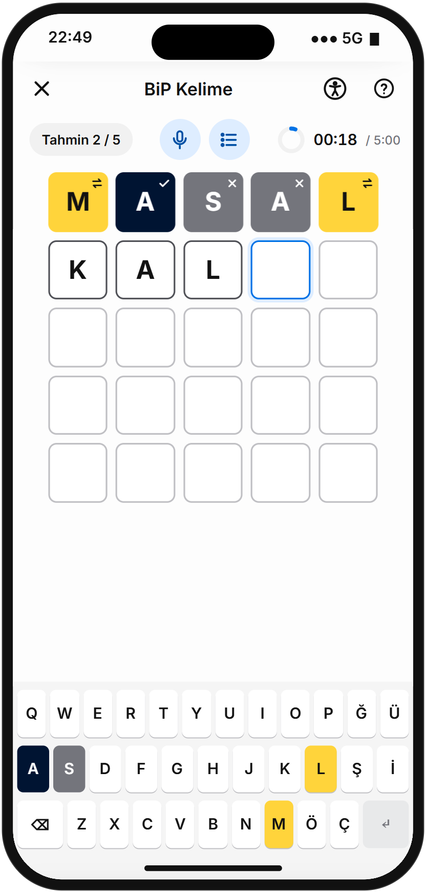 <b>Oyun tahtası</b> Renkler ipucu verir: lacivert doğru yer, sarı yanlış yer, gri kelimede yok. Sözlükte olmayan kelime gönderilemez.</td>
</tr>
<tr>
<td align="center" valign="top">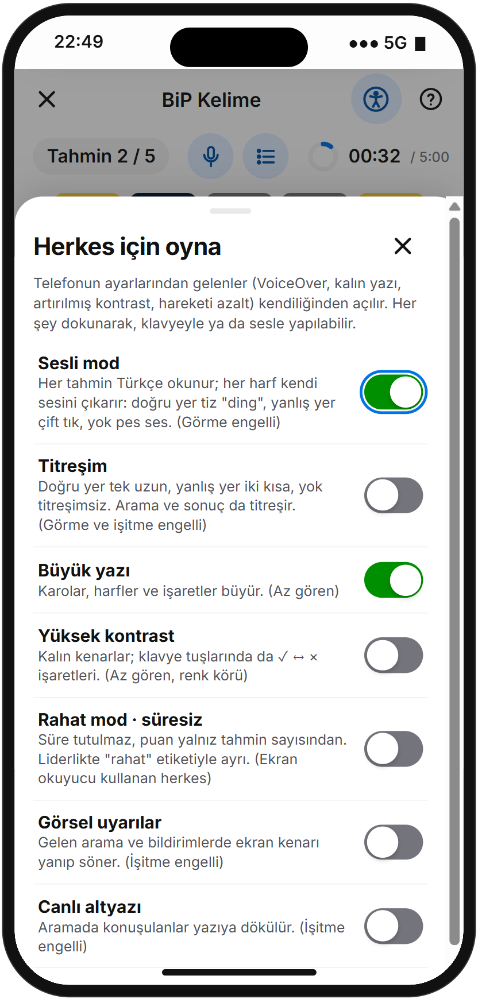 <b>Herkes için oyna</b> Sesli mod, titreşim, büyük yazı, yüksek kontrast ve süresiz rahat mod. Görmesen de oynayabilirsin.</td>
<td align="center" valign="top">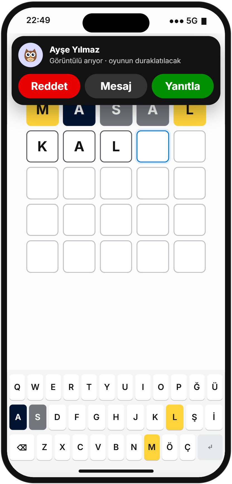 <b>Oyunda arama geldi</b> Oyun sırasında gelen aramada Reddet, Mesaj ve Yanıtla çıkar. Aramadayken oyun süresi durur.</td>
<td align="center" valign="top">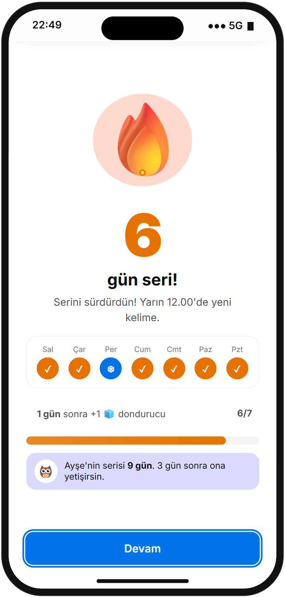 <b>Günlük seri</b> Gün serisi, haftalık takip, kazanılan dondurucu ve arkadaşınla seri karşılaştırması.</td>
</tr>
<tr>
<td></td>
<td align="center" valign="top">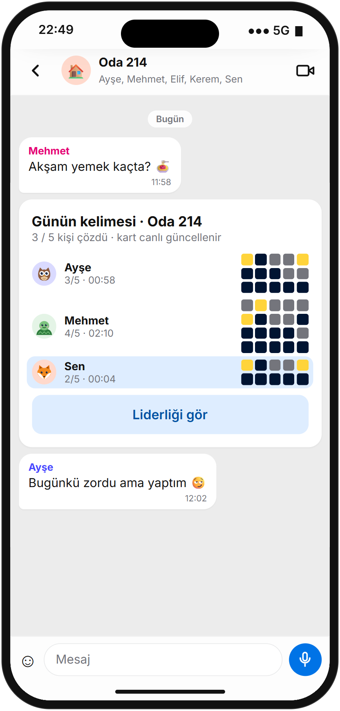 <b>Grup sohbeti</b> Sonucu gönderince grup sohbetindeki "Günün kelimesi" kartı canlı güncellenir. Arkadaşların sonuçları renklerle görünür, kelime gizli kalır.</td>
<td></td>
</tr>
</table>
